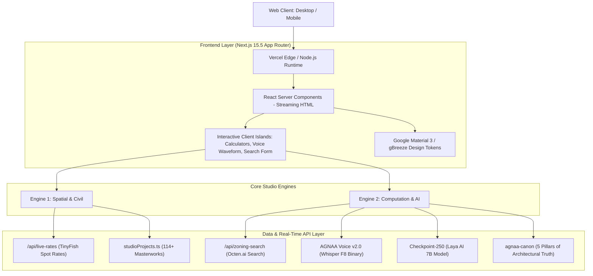

# SPEC-01: AGNAA System Architecture & Technology Stack

* **Document ID:** SPEC-01-ARCH
* **Authors:** Ar. M. Sridhar Chauhan (SPA Delhi, CA/2023/161405), Antigravity Agent
* **Status:** Approved
* **Date:** 2026-11-02

--------------------------------------------------------------------------------

## 1. Architectural Vision & Dual-Engine Topology

`agnaa.in` is engineered as a unified digital platform serving two complementary business and operational engines:

---

## 2. Server Components vs. Client Islands

To guarantee sub-second First Contentful Paint (FCP) and optimal SEO crawlability for Googlebot and Perplexity, the codebase strictly adheres to the **Islands Architecture**:

1. **Server Components by Default:**
   - Homepage static wrappers, monumental hero layout, project metadata headers, and footer directories are rendered as Server Components (RSC).
   - Zero JavaScript shipped to the browser for static marketing and architectural copy.
2. **Targeted Client Islands (`"use client"`):**
   - **Voice Simulator Island:** Real-time audio waveform and mode switching.
   - **Live Zoning Search Island:** Form submission, state management, and citation rendering.
   - **Calculators Islands (`/calc/*`):** Reactive input sliders, SVG interactive geometry renderers, and PDF report downloads.
   - **Projects Ledger Filter Island:** Client-side category switching without page reloads.

---

## 3. Real-Time API Subsystems

### 3.1 Octen.ai Statutory Retrieval (`/api/zoning-search`)
* **Endpoint:** `POST /api/zoning-search`
* **Payload:** `{ "query": string }`
* **Execution Flow:**
  1. Validates and sanitizes incoming architectural/byelaw question.
  2. Forwards query to `https://api.octen.ai/search` with context keywords (*"Telangana Hyderabad GHMC TG-bPASS NBC 2026"*).
  3. Returns structured citations (`title`, `url`, `snippet`, `sourceDomain`) with sub-650ms round-trip latency.
  4. Client renders highlighted excerpts with clickable verified links.

### 3.2 TinyFish Live Wholesale Escrow Index (`/api/live-rates`)
* **Endpoint:** `GET /api/live-rates`
* **Data Store:** Cached in [`src/data/liveRates.json`](file:///i:/AGNAA/agnaa_in/src/data/liveRates.json), refreshed via automated TinyFish crawler.
* **Returned Indices:**
  * Fe 500D TMT Steel (Tata Tiscon / JSW Neosteel) per MT and per kg.
  * OPC 53 Grade Structural Cement (UltraTech / Bharathi) per 50kg bag.
  * Ready-Mix Concrete (M25 design mix) per m³.
  * Manufactured Robo Sand (Plastering grade) per CFT.
  * Blue Metal Granite Aggregate (20mm) per CFT.

---

## 4. Routing & Domain Canonicalization

The application handles multi-domain routing cleanly in [`src/middleware.ts`](file:///i:/AGNAA/agnaa_in/src/middleware.ts):
* **Canonical Host:** All `www.agnaa.in` requests permanently 301-redirected to `https://agnaa.in`.
* **Subdomain Rewrites:**
  * `calc.agnaa.in` ➔ rewritten internally to `/calc`
  * `blog.agnaa.in` ➔ rewritten internally to `/blog`
  * `ai.agnaa.in` ➔ rewritten internally to `/agnaa-intelligence`
  * `client.agnaa.in` ➔ rewritten internally to `/client`
* **Static Asset Bypass:** Regular expression bypass on `_next/static`, images, icons, and PDFs ensures zero middleware overhead on assets.
