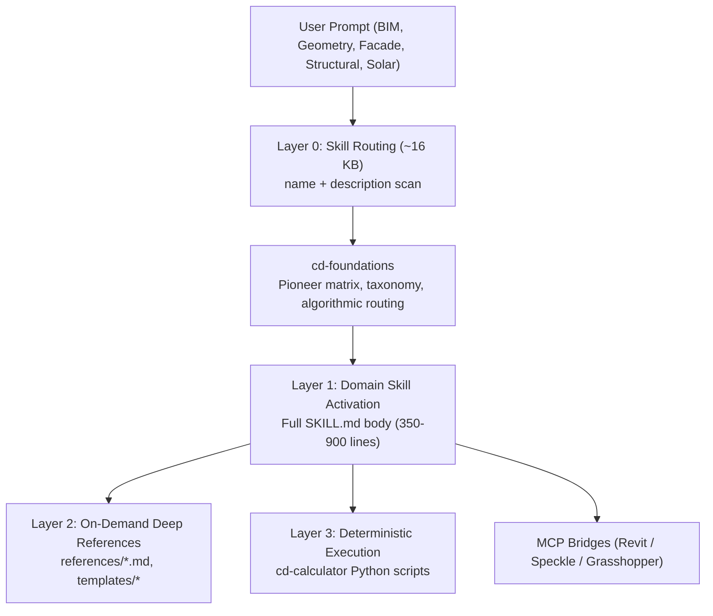

# SPEC-11: Computational Design Skills Suite & Live BIM/CAD Bridges

* **Document ID:** SPEC-11-COMPUTATIONAL-DESIGN-SKILLS-BIM-BRIDGES
* **Authors:** Ar. M. Sridhar Chauhan, Antigravity Agent
* **Status:** Implemented & Verified
* **Date:** 2026-11-03

---

## 1. Executive Summary

To power AGNAA's computational architecture studio, neuro-symbolic CAD workflows, and automated building information modeling, this specification establishes the integration of:
1. **Computational Design Skills Suite:** 18 domain-specialized agent skills (35,000+ lines of domain knowledge, 50+ pioneer frameworks, standards from buildingSMART, ASHRAE, and Eurocodes) deployed into `.claude/skills/` (for Claude Code) and `.agents/skills/` (for Antigravity and multi-agent swarms).
2. **Deterministic Python Calculators:** 7 standalone CLI computation scripts in `.claude/skills/cd-calculator/scripts/` covering cross-section geometry, Euler buckling and deflection, solar angles, quad mesh planarity, manifold integrity, carbon takeoff, and CNC nesting.
3. **Live BIM & CAD Model Context Protocol (MCP) Bridges:** Cloned upstream bridges in `integrations/` linking agent reasoning directly to Autodesk Revit 2024–2027 sessions (`aec-model-bridge`), Speckle 3D data hubs (`speckle-mcp`), and Rhino/Grasshopper canvases (`grasshopper-mcp`).

---

## 2. Progressive Disclosure Architecture

The skills follow a 3-layer progressive disclosure architecture to maintain minimal context overhead:



* **Layer 0 (Discovery):** Only skill names and descriptions are exposed in the system prompt.
* **Layer 1 (Body Execution):** Full `SKILL.md` loads only when triggered by explicit slash commands or domain keywords.
* **Layer 2 (Reference Retrieval):** In-depth mathematical formulas, component taxonomies, and file-format encyclopedias in `references/` load on-demand.
* **Layer 3 (Deterministic Compute):** Precise calculations are delegated to local Python CLI tools rather than LLM token guessing.

---

## 3. The 18 Specialized Computational Design Skills

| # | Skill Directory | Slash Invocation | Domain Scope & Methodologies |
| :--- | :--- | :--- | :--- |
| 1 | `cd-foundations` | *Automatic* | 25+ pioneers (Otto, Schumacher, Burry, Menges), 12 paradigms, tool taxonomies, anti-patterns. |
| 2 | `parametric-modeling` | `/parametric-modeling` | Grasshopper data tree operations, Dynamo node graphs, DAG dependencies, associative geometry. |
| 3 | `computational-geometry` | `/computational-geometry` | NURBS curves/surfaces, B-splines, subdivision surfaces, Voronoi/Delaunay tessellations, boolean ops. |
| 4 | `algorithmic-patterns` | `/algorithmic-patterns` | L-systems, cellular automata, agent-based flocking, reaction-diffusion, space-colonization packing. |
| 5 | `generative-design` | `/generative-design` | Multi-objective genetic algorithms (NSGA-II), design space exploration, fitness function formulation. |
| 6 | `structural-computation` | `/structural-computation` | FEA fundamentals, funicular form-finding, gridshells, Karamba3D and Kangaroo spring systems. |
| 7 | `environmental-simulation` | `/environmental-simulation` | Solar radiation, daylight autonomy (sDA / ASE), CFD natural ventilation, U-values, Ladybug Tools. |
| 8 | `facade-computation` | `/facade-computation` | Panel rationalization, cold-bent glass limit states, developable surfaces, curtain wall systems. |
| 9 | `digital-fabrication` | `/digital-fabrication` | CNC 3-axis/5-axis toolpaths, robotic fabrication (RAPID), timber joinery, 3D printing slicing. |
| 10 | `bim-scripting` | `/bim-scripting` | Autodesk Revit API, pyRevit Python scripts, Dynamo for Revit, openBIM IFC4x3 schema inspection. |
| 11 | `interoperability` | `/interoperability` | Data pipelines across Rhino, Revit, Blender, IFC, gbXML, Speckle, and Rhino.Inside bridges. |
| 12 | `mesh-processing` | `/mesh-processing` | Half-edge data structures, remeshing, quad meshing, UV unrolling, mesh repair and manifold checks. |
| 13 | `optimization-methods` | `/optimization-methods` | Genetic algorithms, simulated annealing, PSO, gradient descent, structural topology optimization. |
| 14 | `data-driven-design` | `/data-driven-design` | GIS integration, space syntax (axial/segment integration), IoT sensor telemetry, urban analytics. |
| 15 | `design-automation` | `/design-automation` | Rule-based space planning, automated floorplan layouts, regulatory compliance checking. |
| 16 | `ml-for-aec` | `/ml-for-aec` | Computer vision for drawings, diffusion layout generation, surrogate performance ML models. |
| 17 | `scripting-reference` | `/scripting-reference` | RhinoCommon (Python/C#), rhinoscriptsyntax, pyRevit, Three.js web graphics. |
| 18 | `cd-calculator` | `/cd-calculator` | 7 standalone CLI Python calculators for deterministic structural, solar, and geometry math. |

---

## 4. Deterministic Python Calculators (`cd-calculator`)

Located at `.claude/skills/cd-calculator/scripts/`:

### 4.1 Cross-Section Geometry (`geometry_calculator.py`)
Computes area, perimeter, centroid, second moment of area ($I_x, I_y$), section modulus ($S_x, S_y$), and radius of gyration ($r_x, r_y$) for standard shapes (I-beam, hollow-rect, rectangle, circle, L-shape, T-shape, arbitrary 2D polygon).
```bash
python .claude/skills/cd-calculator/scripts/geometry_calculator.py \
  --shape i-beam --width 200 --height 400 --flange-thickness 20 --web-thickness 12 --json
```

### 4.2 Structural Checker (`structural_checker.py`)
Validates beam deflection against serviceability limit states ($L/240$, $L/360$), Euler column buckling ($P_{cr} = \frac{\pi^2 E I}{(K L)^2}$), and combined bending/axial stress.

### 4.3 Solar Calculator (`solar_calculator.py`)
Deterministic solar position calculation (solar azimuth, altitude, declination, hour angle) and solar incidence angle $\theta$ for any facade tilt and orientation.

### 4.4 Panel Optimizer (`panel_optimizer.py`)
Computes quadrilateral out-of-plane deviation, checks planarity tolerance ($\le 5\text{ mm}$ for flat glass), and calculates cold-bending surface stress ($\sigma = \frac{E \cdot t \cdot \delta}{a \cdot b}$) to ensure glass fracture prevention.

### 4.5 Mesh Analyzer (`mesh_analyzer.py`)
Evaluates manifold status, detects non-manifold edges/vertices, flags inverted normal orientations, and assesses aspect ratio distortion.

### 4.6 Material Estimator (`material_estimator.py`)
Calculates cubic volume, dry/wet densities, total metric tonnage, and embodied carbon ($\text{kg CO}_2\text{e}$) for concrete mixes (M20–M50), structural steel sections, and mass timber (CLT/glulam).

### 4.7 Fabrication Calculator (`fabrication_calculator.py`)
Estimates CNC milling cycle times, feed-rate acceleration limits, nesting packing efficiencies on standard $2440 \times 1220\text{ mm}$ sheets, and kerf wastage.

---

## 5. Live BIM & CAD Model Context Protocol (MCP) Bridges

The four upstream repositories cloned into `integrations/`:

| Integration Directory | Upstream Repository | Purpose & Architecture |
| :--- | :--- | :--- |
| `integrations/computational-design-skills` | `Abhinavbwj/Claude-skills-for-Computational-Designers` | Primary open-source repository containing the 18-skill suite, references, and tests. |
| `integrations/aec-model-bridge` | `Sam-AEC/aec-model-bridge` | Dual-process bridge connecting Claude/agents to Autodesk Revit (2024–2027) via local socket server and C# .NET add-in. Features 100+ tools for querying elements, parameters, categories, sheets, views, and human-in-the-loop change proposals. |
| `integrations/speckle-mcp` | `bimgeek/speckle-mcp` | Fast Python MCP server interacting with Speckle data hubs. Enables natural language queries over versioned 3D geometry, coordinate systems, and object attributes across Revit, Rhino, and Archicad. |
| `integrations/grasshopper-mcp` | `alfredatnycu/grasshopper-mcp` | Python MCP bridge and C# Grasshopper component (`GH_MCP.gha`) providing programmatic component placement, wire connection, and parameter setting on the active GH canvas. |

---

## 6. Directory Layout & Distribution Matrix

```
i:\AGNAA\agnaa_in\
├── .claude/
│   └── skills/                       <-- Active Claude Code Project Skills (18 skills)
│       ├── algorithmic-patterns/
│       ├── bim-scripting/
│       ├── cd-calculator/
│       │   └── scripts/             <-- 7 Python calculation engines
│       ├── ...
│       └── structural-computation/
├── .agents/
│   └── skills/                       <-- Active Antigravity / Agent Swarm Skills (18 skills)
├── integrations/                     <-- Cloned Upstream Repositories (excluded in tsconfig & git)
│   ├── aec-model-bridge/
│   ├── computational-design-skills/
│   ├── grasshopper-mcp/
│   └── speckle-mcp/
├── CLAUDE.md                         <-- Project-level Claude instruction manifest
└── docs/designs/
    └── computational_design_and_bim_bridges.md  <-- This architectural specification
```

In addition, the 18 skills are mirrored to `C:\Users\sridh\.claude\skills\` to provide machine-wide availability for Claude Code across any project or terminal session.
