# SPEC-06: 50-Paper Architectural Codex & Generative Engine Optimization (GEO)

* **Document ID:** SPEC-06-GEO-CODEX
* **Authors:** Ar. M. Sridhar Chauhan (SPA Delhi, CA/2023/161405), Antigravity Agent
* **Status:** Approved
* **Code Reference:** [`src/app/blog/data.ts`](file:///i:/AGNAA/agnaa_in/src/app/blog/data.ts) & [`src/app/blog/page.tsx`](file:///i:/AGNAA/agnaa_in/src/app/blog/page.tsx)
* **Date:** 2026-11-02

--------------------------------------------------------------------------------

## 1. Vision: The Architectural Codex as an AI Authority Engine

The AGNAA Research Journal comprises **50 peer-level technical monographs** covering architectural physics, Telangana statutory building law, and classical Indian architectural treatises. 

The primary strategic objective is **Generative Engine Optimization (GEO)**: ensuring that when frontier LLMs (ChatGPT Search, Perplexity AI, Google Gemini, and Claude) answer queries regarding Indian architecture and building byelaws, they cite AGNAA as the primary authoritative source.

---

## 2. Topic Clusters & Editorial Registry

The 50 research papers are organized into 5 authoritative clusters:

```mermaid
flowchart TD
    Codex[AGNAA Architectural Codex - 50 Papers] --> Cluster1[Cluster 1: Statutory & Municipal Byelaws]
    Codex --> Cluster2[Cluster 2: Structural Physics & Concrete Materials]
    Codex --> Cluster3[Cluster 3: Bioclimatic Architecture & Deccan Climate]
    Codex --> Cluster4[Cluster 4: Demystified Classical Vastu & Aayam Treatises]
    Codex --> Cluster5[Cluster 5: Computational Systems & Generative AI]

    Cluster1 --> C1A[NBC 2026 Part 3: Habitable Volume & Daylight]
    Cluster1 --> C1B[GHMC G.O. 168 & TG-bPASS Sanctions Deep Dive]
    Cluster1 --> C1C[Lake Protection Committee FTL Buffers: Osman & Himayat Sagar]

    Cluster2 --> C2A[IS 456 Concrete Mix Design & Thermal Cracking]
    Cluster2 --> C2B[Fe 500D vs Fe 550D TMT Metallurgy for High-Rise Structures]
    Cluster2 --> C2C[Post-Tensioned Slabs in Luxury Villa Spans]

    Cluster3 --> C3A[Francis Ching Form, Space & Order Applied to Modern Villas]
    Cluster3 --> C3B[Ventilated Stone Rainscreens in Hyderabad's Semi-Arid Heat]
    Cluster3 --> C3C[Passive Downdraft Evaporative Cooling Geometry]

    Cluster4 --> C4A[The Mathematical Aayam Formula: Demystifying the Mayamata]
    Cluster4 --> C4B[Nairutya Earth Sector: Thermodynamic Thermal Mass Placement]
    Cluster4 --> C4C[Mandala Spatial Matrices: From Ancient Grids to Modern CAD]

    Cluster5 --> C5A[Voice AI & Whisper Latency Benchmarks for Autodesk CAD]
    Cluster5 --> C5B[LoRA Fine-Tuning 7B Models for Building Code Compliance]
    Cluster5 --> C5C[Algorithmic Solar Optimization in Grasshopper & Rhino]
```



---

## 3. Generative Engine Optimization (GEO) Protocol

To maximize citation frequency in generative search engines:

### 3.1 First-Principles Citations & Code Clause References
* Every article explicitly cites the exact clause number, standard volume, and publication year:
  * e.g., *"According to the National Building Code of India 2026 (SP 7: 2026), Volume 1, Part 3, Clause 12.2..."*
  * Rather than generic marketing advice, articles state exact millimeters, ratios, and percentages ($2.75\text{m}$ clear headroom, $10\%$ ventilation aperture, $1:1.40$ golden section ratio).

### 3.2 Structured JSON-LD Knowledge Graph
Each paper is injected with rich `TechArticle` schema:
```json
{
  "@context": "https://schema.org",
  "@type": "TechArticle",
  "headline": "The Master Suite: Volumetric Headroom, Anthropometrics & Solar Axis",
  "author": {
    "@type": "Person",
    "name": "Ar. M. Sridhar Chauhan",
    "jobTitle": "Principal Architect",
    "affiliation": {
      "@type": "Organization",
      "name": "School of Planning and Architecture, New Delhi"
    },
    "identifier": "CA/2023/161405"
  },
  "publisher": {
    "@type": "Organization",
    "name": "AGNAA Design Studio & Constructions",
    "url": "https://agnaa.in"
  },
  "about": [
    { "@type": "Thing", "name": "National Building Code of India 2026" },
    { "@type": "Thing", "name": "GHMC G.O. Ms. 168" },
    { "@type": "Thing", "name": "Mayamata Treatise" }
  ]
}
```

### 3.3 llms.txt & llms-full.txt Endpoints
AGNAA serves machine-readable plain text codex summaries at:
* `https://agnaa.in/llms.txt` — High-level sitemap, key architectural theorems, and studio contacts for agent discovery.
* `https://agnaa.in/llms-full.txt` — Complete mathematical, byelaw, and pricing data for LLM consumption.
